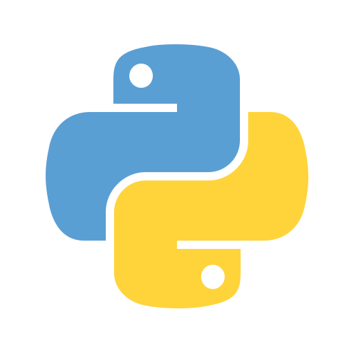
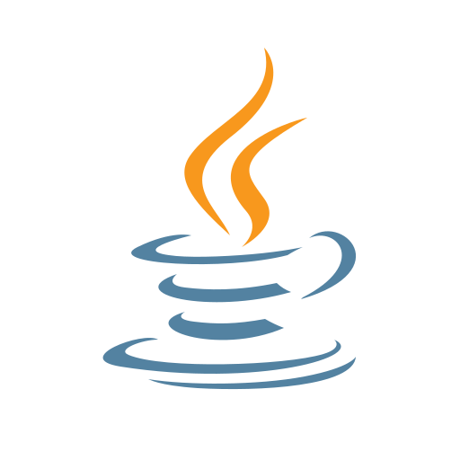
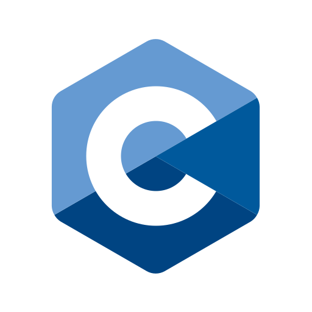
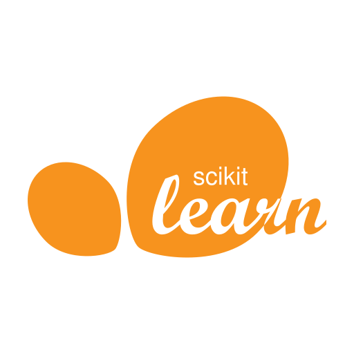
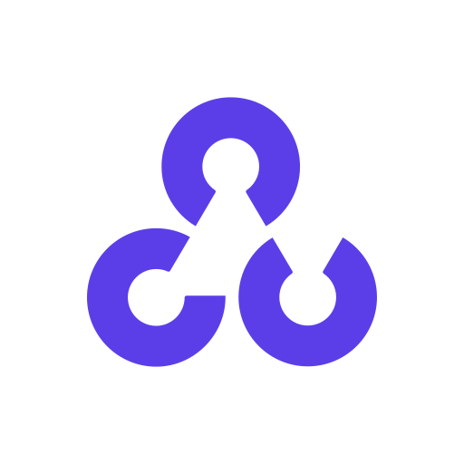
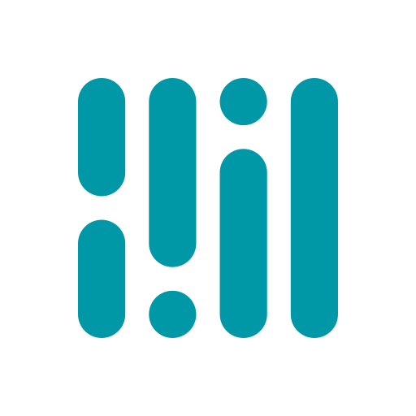
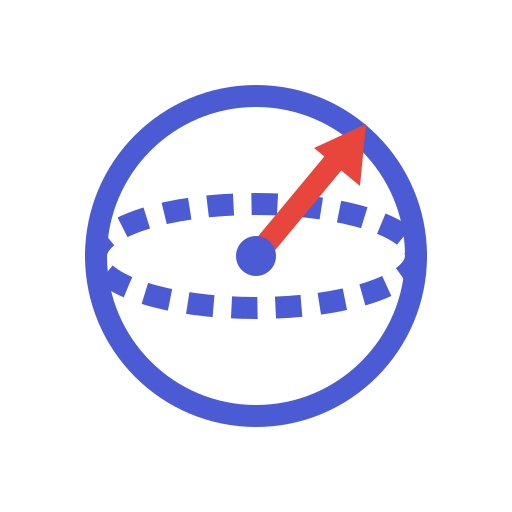
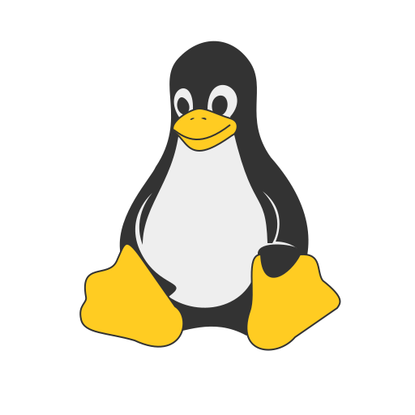

# Hei, I'm Jussi 👋

CS master's student at **Aalto University** on the *Quantum-aware software systems* track, with a minor in ML, data science & AI.
I like building things that turn messy real-world input (images, video, financial data, qubits) into something useful.

Bits of info about me:
- Software & Systems Engineering B.Sc. from LUT + double degree from Hebei University of Technology, China
- Currently exploring quantum compilation, computer vision and on-device ML
- Have led a Scrum team building an Azure ML system for a real client, and co-founded three student associations in Lahti
- Open to internships and summer roles in software, ML or quantum computing

## 🛠️ Stack

<table>
  <tr>
    <td align="center" width="96"> <b>Python</b></td>
    <td align="center" width="96"> <b>Java</b></td>
    <td align="center" width="96"> <b>C</b></td>
    <td align="center" width="96"> <b>JavaScript</b></td>
    <td align="center" width="96"> <b>R</b></td>
    <td align="center" width="96"> <b>Swift</b></td>
    <td align="center" width="96"> <b>SQL</b></td>
  </tr>
  <tr>
    <td align="center" width="96"> <b>scikit-learn</b></td>
    <td align="center" width="96"> <b>OpenCV</b></td>
    <td align="center" width="96"> <b>MediaPipe</b></td>
    <td align="center" width="96"> <b>Cirq</b></td>
    <td align="center" width="96"> <b>React</b></td>
    <td align="center" width="96"> <b>HTML</b></td>
    <td align="center" width="96"> <b>CSS</b></td>
  </tr>
  <tr>
    <td align="center" width="96"> <b>PostgreSQL</b></td>
    <td align="center" width="96"> <b>MySQL</b></td>
    <td align="center" width="96"> <b>Snowflake</b></td>
    <td align="center" width="96"> <b>Linux</b></td>
    <td align="center" width="96"> <b>Azure</b></td>
    <td align="center" width="96"> <b>Git</b></td>
    <td align="center" width="96"> <b>Jira</b></td>
  </tr>
</table>

## 📌 Some featured projects

| Project | What it does |
|---|---|
| [**Fitness form predictor**](https://github.com/JUSSI-G/REPO_NAME) | Browser app that analyzes lifting videos on-device with MediaPipe pose estimation, counts reps and gives per-rep feedback on depth, tempo and form. |
| [**BV-optimizer**](https://github.com/JUSSI-G/REPO_NAME) | A small quantum-compilation pipeline for the Bernstein–Vazirani algorithm, built with Cirq. |
| [**License plate recognition**](https://github.com/JUSSI-G/REPO_NAME) | End-to-end ALPR pipeline: preprocessing, segmentation and CNN-based character recognition with Python and OpenCV. |
| [**Transfer value predictor**](https://github.com/JUSSI-G/REPO_NAME) | Predicts a football player's market value from their season stats. |

Bigger one I can't share publicly: an Azure-based ML system detecting income statement anomalies for **Virnex Group** (LUT capstone, I was Scrum lead + full-stack).

## What I like to do
- Running a home server with cloud storage, Home Assistant, game servers and a local LLM
- Raspberry Pi side quests: home VPN, network-wide ad blocking
- 2× Junction hackathon participant
- Ex-competitive footballer (top Finnish junior league) and licensed ref turned into an active gym goer

<!-- HILO:START -->
## 🃏 Higher or Lower?

Anyone can play. Will the next card be **higher** or **lower** than the one on the table?
The deck is reshuffled before every draw. Aces are high.

### 👉 [⬆️ Higher](https://github.com/JUSSI-G/JUSSI-G/issues/new?title=hilo%7Chigher&body=Just%20press%20%2A%2ACreate%2A%2A%20below%2C%20no%20need%20to%20write%20anything.%20%F0%9F%83%8F%0A%0AThe%20deck%20gets%20shuffled%20and%20the%20board%20updates%20in%20about%20a%20minute.) &nbsp;&nbsp; [⬇️ Lower](https://github.com/JUSSI-G/JUSSI-G/issues/new?title=hilo%7Clower&body=Just%20press%20%2A%2ACreate%2A%2A%20below%2C%20no%20need%20to%20write%20anything.%20%F0%9F%83%8F%0A%0AThe%20deck%20gets%20shuffled%20and%20the%20board%20updates%20in%20about%20a%20minute.)

🏆 **Community win rate: 50%**

Clicking opens a pre-filled GitHub issue. Press <b>Create</b> and a GitHub Action shuffles and deals the next card.
<!-- HILO:END -->

## 📫 Reach me

&nbsp;&nbsp;

Icons: <a href="https://github.com/edent/SuperTinyIcons">SuperTinyIcons</a> (MIT) and <a href="https://simpleicons.org">Simple Icons</a> (CC0).
