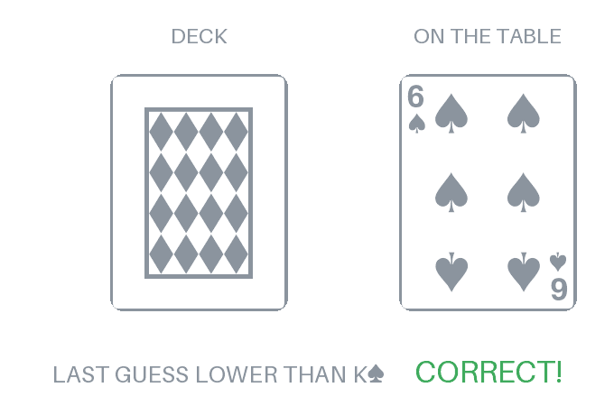

# Hei, I'm Jussi 👋

CS master's student at **Aalto University** on the *Quantum-aware software systems* track, with a minor in ML, data science & AI. In parallel, I'm doing an M.Sc. in Software Product Management & Business at **LUT**. I'm interested in both the technical and business sides of software.

I like building things that turn real-world input (images, video, financial data, qubits) into something useful.

Bits of info about me:
- Software & Systems Engineering B.Sc. from LUT + double degree from Hebei University of Technology, China
- Currently exploring quantum compilation, computer vision and on-device ML
- Have led a Scrum team building an Azure ML system for a real client, and co-founded three student associations in Lahti

## 🛠️ Stack

<table>
  <tr>
    <td align="center" width="96"> <b>Python</b></td>
    <td align="center" width="96"> <b>Java</b></td>
    <td align="center" width="96"> <b>C</b></td>
    <td align="center" width="96"> <b>JavaScript</b></td>
    <td align="center" width="96"> <b>R</b></td>
    <td align="center" width="96"> <b>Swift</b></td>
    <td align="center" width="96"> <b>SQL</b></td>
  </tr>
  <tr>
    <td align="center" width="96"> <b>scikit-learn</b></td>
    <td align="center" width="96"> <b>OpenCV</b></td>
    <td align="center" width="96"> <b>MediaPipe</b></td>
    <td align="center" width="96"> <b>Cirq</b></td>
    <td align="center" width="96"> <b>React</b></td>
    <td align="center" width="96"> <b>HTML</b></td>
    <td align="center" width="96"> <b>CSS</b></td>
  </tr>
  <tr>
    <td align="center" width="96"> <b>PostgreSQL</b></td>
    <td align="center" width="96"> <b>MySQL</b></td>
    <td align="center" width="96"> <b>Snowflake</b></td>
    <td align="center" width="96"> <b>Linux</b></td>
    <td align="center" width="96"> <b>Azure</b></td>
    <td align="center" width="96"> <b>Git</b></td>
    <td align="center" width="96"> <b>Jira</b></td>
  </tr>
</table>

## 📌 Some featured projects

| Project | What it does |
|---|---|
| [**Fitness form predictor**](https://github.com/JUSSI-G/formcheck) | Browser app that analyzes lifting videos on-device with MediaPipe pose estimation, counts reps and gives per-rep feedback on depth, tempo and form. |
| [**BV-optimizer**](https://github.com/JUSSI-G/bv-optimizer) | A small quantum-compilation pipeline for the Bernstein–Vazirani algorithm, built with Cirq. |
| [**BoxBox**](https://github.com/JUSSI-G/BoxBox) | F1 strategy analysis across 30 years of pit stops with XGBoost and a Flask dashboard, testing whether software has made strategy mistakes matter less. Built from my bachelor's thesis. |

Bigger one I can't share publicly: an Azure-based ML system detecting income statement anomalies for **Virnex Group** (LUT capstone, I was Scrum lead + full-stack).

## What I like to do
- Running a home server with cloud storage, Home Assistant, game servers and a local LLM
- Raspberry Pi side quests: home VPN, network-wide ad blocking
- 2× Junction hackathon participant
- Ex-competitive footballer (top Finnish junior league) and licensed ref turned into an active gym goer

<!-- HILO:START -->
## Higher or Lower?

Anyone can play. Will the next card be **higher** or **lower** than the one on the table?
The deck is reshuffled before every draw. Aces are high. Each month's first 100 draws are made using quantum vacuum fluctuations measured by the <a href="https://quantumnumbers.anu.edu.au">ANU Quantum Random Numbers</a> lab, because it creates true randomness (and it's cool).

Recent: K♠ · K♣ · A♦

### [▲ Higher](https://github.com/JUSSI-G/JUSSI-G/issues/new?title=hilo%7Chigher&body=Just%20press%20%2A%2ACreate%2A%2A%20below%2C%20no%20need%20to%20write%20anything.%0A%0AYour%20result%20appears%20here%20as%20a%20comment%20in%20about%20a%20minute.%20You%20can%20also%20refresh%20the%20profile%20page%20to%20see%20the%20new%20card.) &nbsp;&nbsp;·&nbsp;&nbsp; [▼ Lower](https://github.com/JUSSI-G/JUSSI-G/issues/new?title=hilo%7Clower&body=Just%20press%20%2A%2ACreate%2A%2A%20below%2C%20no%20need%20to%20write%20anything.%0A%0AYour%20result%20appears%20here%20as%20a%20comment%20in%20about%20a%20minute.%20You%20can%20also%20refresh%20the%20profile%20page%20to%20see%20the%20new%20card.)
**Community win rate: 62%**

**Just played? Give it up to a minute, then refresh the page to see your card.**

Clicking opens a pre-filled GitHub issue. Press <b>Create</b> and a GitHub Action shuffles and deals the next card.
<!-- HILO:END -->

## 📫 Reach me

  &nbsp;&nbsp;<a href="https://www.linkedin.com/in/jussi-gr%C3%B6nroos">LinkedIn</a>&nbsp;&nbsp;&nbsp;&nbsp;&nbsp;&nbsp;&nbsp;&nbsp;
  &nbsp;&nbsp;<a href="https://gronroos.dev">Portfolio</a>&nbsp;&nbsp;&nbsp;&nbsp;&nbsp;&nbsp;&nbsp;&nbsp;
  &nbsp;&nbsp;<a href="mailto:jussi@gronroos.dev">Email</a>

Icons: <a href="https://github.com/edent/SuperTinyIcons">SuperTinyIcons</a> (MIT) and <a href="https://simpleicons.org">Simple Icons</a> (CC0).
